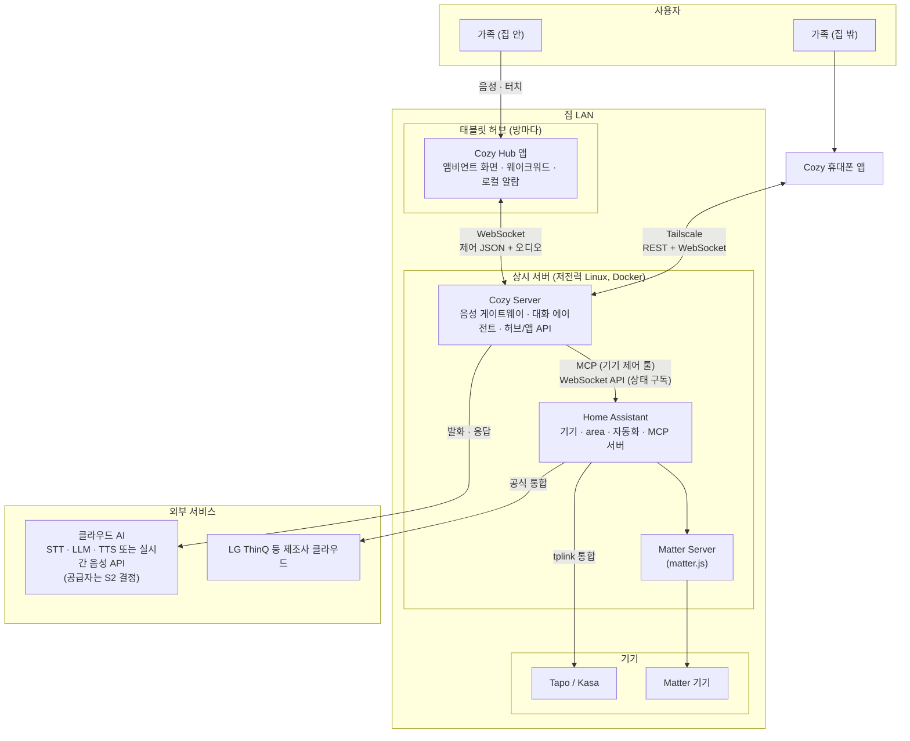
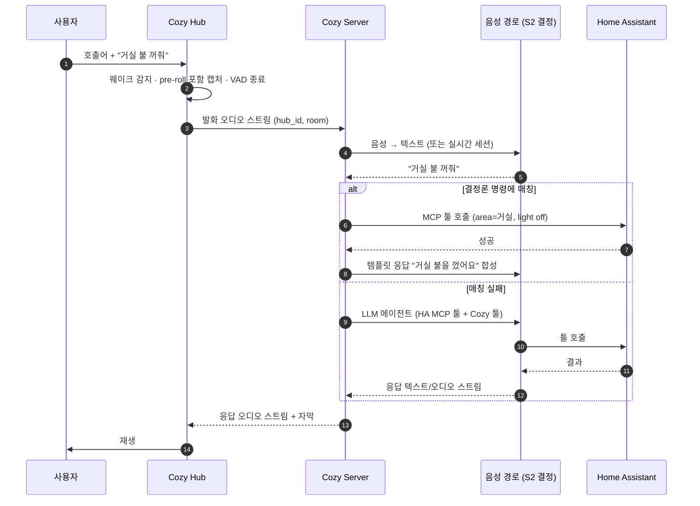
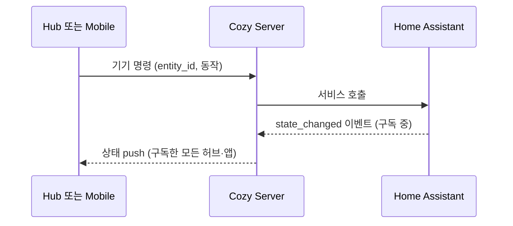
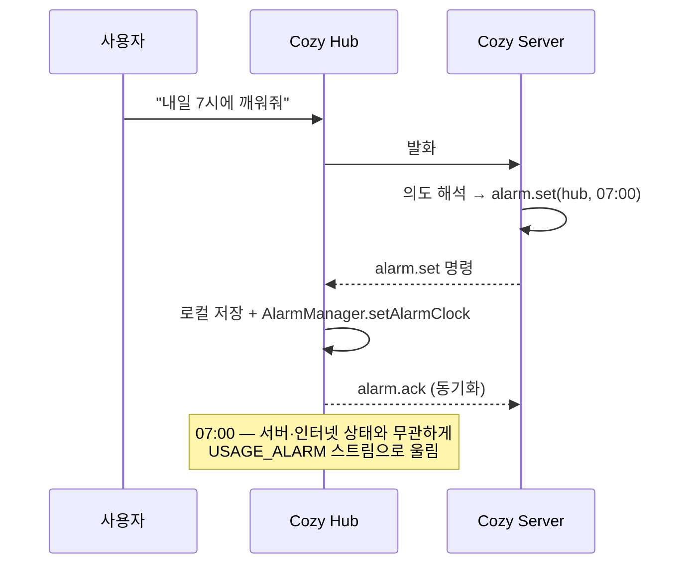

# 전체 시스템 아키텍처

Cozy Buddy는 세 가지로 구성한다. 집 안 상시 서버, 방마다 두는 태블릿 허브, 외부에서 쓰는 휴대폰 앱이다.
기기 연결과 자동화는 Home Assistant(HA)에 맡기고, 직접 만드는 것은 한국어 음성 경험, 앰비언트 허브
UI, 휴대폰 앱이다. 이 문서는 [이전 설계 검토](../review/2026-11-13-legacy-design-adversarial-review.md)의
기본 가설을 목표 구조로 옮긴 초안이다. 스파이크 결과에 따라 바뀌는 지점은 각 절에 표시한다.
컴포넌트별 상세는 [서버](0002-server-architecture.md), [허브](0003-hub-architecture.md),
[휴대폰 앱](0004-mobile-architecture.md) 설계안에 있다. 네 설계안의 구조를 한 장씩 그린 그림은
[`docs/diagrams/architecture.html`](../diagrams/architecture.html)에 있다.

## 제안 요약

목표는 가족이 매일 쓰는 짧은 작업 몇 가지를 확실하게 처리하는 것이다. Nest Hub의 기능 목록을 모두
따라가는 것은 목표가 아니다. 첫 완료 기준은 다음 루프다.

> 태블릿 1대에서 호출어(또는 화면 탭) → 한국어 명령 → 기기 1종 제어 → 한국어 음성 응답.
> 같은 태블릿에서 음성으로 맞춘 알람이 서버나 인터넷 없이도 울린다.

이 루프를 가족이 1주 동안 매일 쓰고 실패율을 잴 수 있게 되기 전에는 기능을 늘리지 않는다.

설계 원칙은 이전 설계의 P1~P6을 대체한다.

| 원칙 | 의미 | 근거 |
|---|---|---|
| 위임 우선 | 기기 연결, 방(area), 상태, 자동화, Matter는 HA가 소유한다. 자체 코드는 HA가 하지 않는 일만 맡는다 | 검토 C4 |
| 실패할 수 없는 기능은 가장자리에 | 알람·타이머는 허브가 로컬에서 소유하고, 서버는 동기화만 한다 | 검토 C3 |
| 오프라인 핵심 경로 | 인터넷이 끊겨도 터치 제어와 알람은 동작한다. 음성은 인터넷이 있어야 동작한다 | 검토 C1, ADR 0001 |
| AI 추론은 클라우드 | STT·LLM·TTS는 클라우드 API만 쓴다. 상시 서버는 GPU 없는 저전력 Linux 머신이다 | 검토 C2, [ADR 0001](../adr/0001-cloud-only-ai-inference.md) |
| 측정 후 결정 | 지연·정확도·비용 수치는 스파이크 실측값만 근거로 쓴다 | 검토 M1 |
| 두 번째 구현 때 추상화 | 인터페이스는 교체 구현이 실제로 생길 때 추출한다 | 검토 M4 |

## 설계

### 시스템 구성

AI 추론은 모두 클라우드에서 한다([ADR 0001](../adr/0001-cloud-only-ai-inference.md)). 허브와 휴대폰 앱은 Cozy Server만 상대하고
HA에 직접 연결하지 않는다. 클라이언트가 아는 계약을 `protocol/` 하나로 유지하고, HA 버전 변화를 서버
한 곳에서 흡수하기 위해서다.

### 구성요소와 책임

| 구성요소 | 소유하는 것 | 소유하지 않는 것 | 상세 |
|---|---|---|---|
| Cozy Hub (Android 태블릿) | 앰비언트 화면, 웨이크워드 감지, 발화 캡처, 응답 재생, 알람·타이머 실행, 방별 기기 대시보드 표시 | 음성 인식, 대화 판단, 기기 연결 | [0003](0003-hub-architecture.md) |
| Cozy Server | 허브·앱 API, 음성 세션, 결정론 명령 처리, LLM 대화 에이전트, HA 상태 중계, 알람 동기화, 허브 간 방송 | 기기 프로토콜, 방·기기 원장, 자동화 스케줄 | [0002](0002-server-architecture.md) |
| Home Assistant | 기기 통합, area(방), 엔티티 상태, 장면·스크립트·자동화, MCP 서버, Matter 컨트롤러 | 한국어 음성 경험, 허브 UI | 외부 |
| Cozy Mobile | 외부에서의 기기 제어, 장면 실행, 허브 알람 조회·설정, 텍스트 대화 | 비즈니스 로직 (서버가 판단) | [0004](0004-mobile-architecture.md) |

### 주요 흐름

#### 음성 명령

실시간 음성 API(S2의 c안)를 채택하면 3~4단계와 응답 합성이 하나의 세션으로 합쳐지고, 툴 호출은 서버가
중계한다. 어느 경우든 허브와 서버 사이 계약(발화 스트림 올림, 응답 스트림 내림)은 같게 유지한다.

#### 터치 제어와 상태 반영

서버는 HA WebSocket API로 노출 대상 엔티티의 상태를 구독하고, 허브와 앱에 필요한 형태로 가공해 보낸다.
기기 목록과 방 구성의 정본은 HA다.

#### 알람

허브가 알람의 정본이고 서버는 사본을 가진다. 휴대폰 앱의 알람 조회·설정은 서버를 거쳐 대상 허브에 전달된다.
허브가 오프라인이면 앱에 "전달 대기"로 표시한다.

### 장애 시 동작

| 상황 | 동작하는 것 | 멈추는 것 |
|---|---|---|
| 인터넷 단절 | 터치 제어(로컬 통합 기기), 알람, HA 자동화. 호출어 감지 후 "인터넷 연결 없음" 안내 | 음성 처리 전체, 제조사 클라우드 기기, 휴대폰 원격 제어 |
| Cozy Server 중단 | 알람, HA 자동화, 허브 시계 화면 | 음성, 대시보드 제어, 휴대폰 앱 |
| Home Assistant 중단 | 알람, 음성 대화(기기 제어 제외) | 기기 제어와 상태 표시 |
| 허브 오프라인 | 해당 허브의 알람 | 해당 방의 음성·대시보드 |

### 컴포넌트 간 계약

| 경계 | 방식 | 정본 |
|---|---|---|
| Hub ↔ Server | WebSocket 1개. 텍스트 프레임은 제어 JSON, 바이너리 프레임은 오디오. 오디오 프레임에 스트림 종류·세션·순번을 담는다(검토 M3) | `protocol/` |
| Mobile ↔ Server | REST + 상태 push용 WebSocket | `protocol/` |
| Server ↔ HA | MCP(기기 제어 툴) + HA WebSocket API(상태 구독·서비스 호출) | HA 문서. 결합 지점을 이 두 곳으로 제한 |
| Server ↔ 클라우드 AI | 공급자 SDK | S2 이후 ADR |

`protocol/`의 스키마 형식(JSON Schema 기반 코드 생성 또는 Protocol Buffers)은 첫 구현 전에 ADR로 정한다.
Kotlin(허브·앱)과 Python(서버) 양쪽 모델을 같은 정의에서 생성할 수 있어야 한다.

### 배치

| 위치 | 실행 단위 | 비고 |
|---|---|---|
| 상시 서버 | Docker Compose: `cozy-server`, `homeassistant`, `matter-server` | 하드웨어는 S4로 결정. HA OS에 Cozy Server를 HA 앱(add-on)으로 올리는 안도 비교 대상 |
| 태블릿 | Cozy Hub APK, HOME 앱으로 지정 | 기종은 S1로 결정 |
| 휴대폰 | Cozy Mobile | 외부 접속은 Tailscale |

레포 구성은 모노레포의 `server/`, `hub/`, `mobile/`, `protocol/`에 대응한다.

### 미결 결정

| 결정 | 근거가 될 스파이크 | 기본 가설 |
|---|---|---|
| 음성 경로 구조(클라우드 단계별 API / 실시간 음성 API / 혼합)와 공급자 | S2, S9 | 짧은 명령은 결정론 경로, 자유 대화만 LLM |
| HA 위임 여부와 범위 | S3 | 기기·area·자동화 전부 위임 |
| 허브를 HA 음성 위성(ESPHome 프로토콜)으로 만들지, 자체 프로토콜로 만들지 | S3, S2 | 자체 프로토콜. 한국어 음성 경로를 직접 통제하기 위해서다. HA 위성 방식이 S3에서 한국어 요건을 충족하면 재검토 |
| 상시 서버 하드웨어 | S4 | 저전력 미니PC |
| 웨이크워드 엔진과 호출어 | S1 | microWakeWord 또는 LiveKit wakeword |
| 키오스크 수준 | S5 | HOME 앱 + 상시 Activity, Device Owner 없음 |
| 휴대폰 앱의 iOS 지원 | 가족 기기 확인 | 0004 참조 |
| `protocol/` 스키마 형식 | 없음(설계 결정) | 첫 구현 전 ADR |
