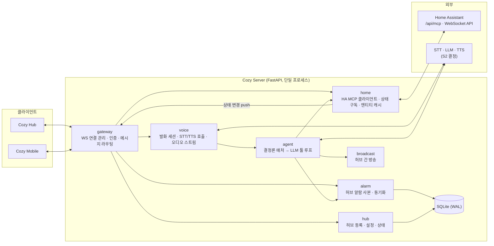
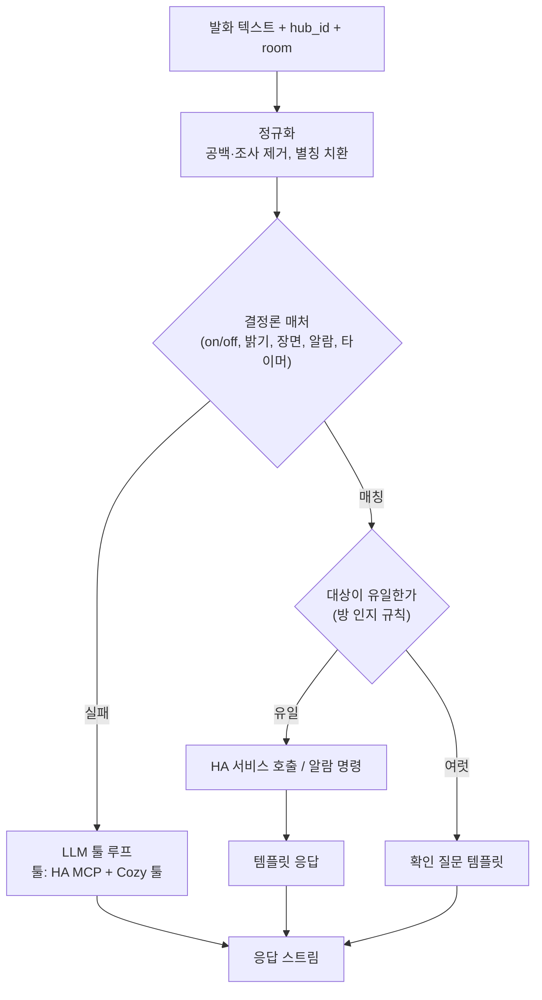
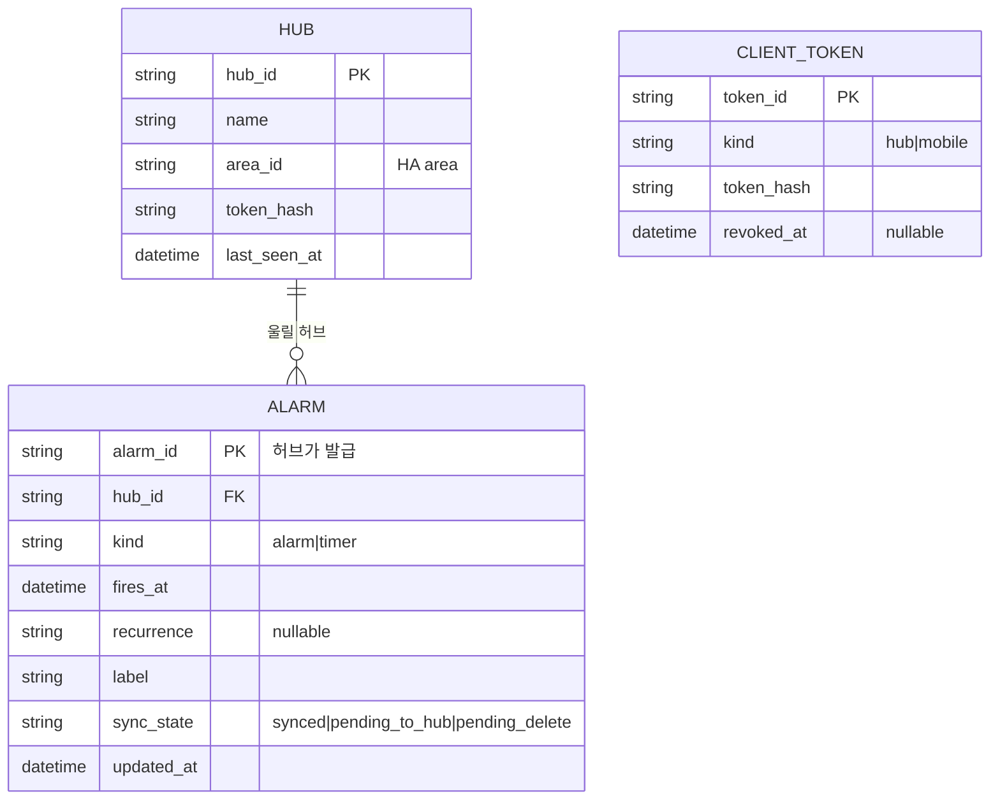

# 서버 아키텍처

Cozy Server는 허브와 휴대폰 앱이 상대하는 유일한 백엔드다. 음성 세션을 처리하고, 한국어 명령을
해석해 Home Assistant(HA)에 실행을 맡기며, HA 상태를 클라이언트에 중계한다. 기기 프로토콜, 방·기기
원장, 자동화 스케줄은 갖지 않는다. 전체 구조와 다른 컴포넌트와의 경계는
[전체 시스템 아키텍처](0001-system-architecture.md)를 따른다.

## 제안 요약

서버가 맡는 일은 다섯 가지다.

1. 허브·앱 게이트웨이: `protocol/` 계약에 따라 WebSocket과 REST를 제공하고 클라이언트를 인증한다.
2. 음성 세션: 허브가 올린 발화를 텍스트로 바꾸고, 응답을 음성으로 만들어 내려보낸다. 엔진은 S2로 정한다.
3. 대화 에이전트: 결정론 명령은 템플릿으로 즉시 처리하고, 나머지는 LLM이 HA MCP 툴과 Cozy 툴로 처리한다.
4. HA 브리지: MCP 클라이언트로 기기를 제어하고, HA WebSocket API로 상태를 구독해 클라이언트에 push한다.
5. Cozy 고유 기능: 허브 등록, 알람 사본과 동기화, 허브 간 방송.

이전 설계에 있던 device·scenario·timer 스케줄러·rag·chat 롤링 요약 도메인은 만들지 않는다.
기기와 자동화는 HA가 소유하고(검토 C4), 대화 이력의 범위는 S9 이후 실제 로그로 정한다(검토 M6).

## 설계

### 구성요소



| 도메인 | 책임 | 저장 |
|---|---|---|
| gateway | 허브·앱 WebSocket 연결과 REST 진입점, 토큰 인증, 메시지를 도메인에 전달 | 없음 (연결 상태는 메모리) |
| voice | 발화 세션 생성·취소, 오디오 수신, STT 호출, 응답 텍스트를 문장 단위로 TTS에 넘겨 오디오 스트림 송신, 한국어 숫자·단위 낭독 정규화(검토 m5) | 없음. 원본 오디오는 저장하지 않음 |
| agent | 결정론 매처(방·기기·동작 문법), 템플릿 응답, LLM 툴 루프, 확인 질문 정책 | 대화 로그(보존 기간은 S9 이후 결정) |
| home | HA MCP 툴 호출, HA WebSocket 상태 구독, 노출 엔티티와 area 캐시, 엔티티 → 클라이언트 표시 모델 변환 | 메모리 캐시 |
| alarm | 허브 알람의 사본, 앱에서 온 설정을 대상 허브에 전달, 전달 대기 상태 | SQLite |
| hub | 허브 등록, 이름·방(HA area) 지정, 허브 상태(연결, 볼륨, 마이크 음소거) | SQLite |
| broadcast | 텍스트를 TTS로 만들어 대상 허브들에 송신 | 없음 |

### 대화 처리 흐름



결정론 매처는 HA의 area와 엔티티 이름에서 어휘를 만들고, 이전 설계의 방 인지 규칙을 따른다(검토에서
유지한 v3 §8-3). 방이 명시되면 그 방을 쓰고, 없으면 발화 허브의 방을 먼저 찾는다. 후보가 여럿이면 확인
질문을 한다. LLM 툴 루프는 검토에서 유지한 결함 체크리스트를 지킨다. 툴 결과는 `role:"tool"`로 주입하고,
마지막 턴을 그대로 스트리밍하며, reasoning 출력은 음성으로 내보내지 않는다.

LLM에 노출하는 툴은 두 묶음이다.

| 묶음 | 툴 | 제공 |
|---|---|---|
| 기기 | HA MCP 서버가 노출하는 툴(상태 조회, 서비스 호출 등) | HA. 노출 엔티티는 HA 설정에서 제한 |
| Cozy | `set_alarm`, `cancel_alarm`, `list_alarms`, `broadcast` | 서버 내부 툴. 외부 에이전트에게도 노출할 필요가 생기면 MCP 서버로 분리 |

실시간 음성 API를 채택하면(S2의 c안) LLM 툴 루프 자리에 실시간 세션 중계가 들어간다. 이때도 결정론
매처를 먼저 거칠지, 세션에 모든 발화를 넘길지는 S2·S9 결과로 정한다.

### HA 연동

| 항목 | 방식 |
|---|---|
| 인증 | HA 장기 액세스 토큰. `.env`로 주입하고 로그에서 마스킹 |
| 기기 제어 | HA 내장 MCP 서버(`/api/mcp`)에 MCP 클라이언트로 연결. 결정론 경로는 같은 연결의 툴을 직접 호출 |
| 상태 | HA WebSocket API로 노출 대상 엔티티의 상태 변경을 구독하고, 재연결 시 전체 상태를 다시 받음 |
| 방 | HA area를 그대로 쓴다. 허브의 방은 area ID로 지정 |
| 결합 지점 | MCP와 WebSocket API 두 곳으로 제한. HA 툴 이름 규칙 변경 같은 변화는 `home` 도메인 안에서 흡수 |

### 코드 구조

전역 개발 규약의 Python 서버 구조(Package-by-Feature, Service-Repository)를 따른다.

```
server/
├── pyproject.toml
├── Dockerfile                  # python:3.12-slim + uv
├── docker-compose.yml          # cozy-server · homeassistant · matter-server · nginx
├── app/
│   ├── main.py                 # app/domain/*/api.py 자동 등록, lifespan에서 HA 연결 기동
│   ├── config.py               # pydantic-settings
│   ├── core/                   # database · exceptions · i18n · logging · security
│   ├── middleware/
│   ├── locales/                # ko.json (사용자 응답 문구, 템플릿 응답)
│   └── domain/
│       ├── gateway/            # ws.py · api.py · service.py
│       ├── voice/              # service.py · stt.py · tts.py · normalize.py
│       ├── agent/              # service.py · matcher.py · tools.py
│       ├── home/               # service.py · mcp_client.py · state.py
│       ├── alarm/              # api.py · service.py · crud.py · schemas.py · models.py
│       ├── hub/                # api.py · service.py · crud.py · schemas.py · models.py
│       └── broadcast/          # api.py · service.py
└── tests/
```

`protocol/`에서 생성한 메시지 모델을 gateway가 사용한다. STT·TTS·LLM 공급자는 S2에서 하나를 고른 뒤
그 하나만 구현한다. 두 번째 공급자가 실제로 필요해질 때 인터페이스를 추출한다(검토 M4).

### 데이터 모델



기기·방·장면은 저장하지 않는다. 알람의 정본은 허브이므로 충돌하면 허브가 보낸 값이 이긴다. 대화 로그
테이블은 S9에서 필요한 보존 범위가 정해진 뒤 추가한다.

### 배포

| 항목 | 결정 |
|---|---|
| 실행 | Docker Compose. Gunicorn + Uvicorn worker **1개**. WebSocket 연결과 HA 구독을 프로세스 메모리에 두므로 워커를 늘리지 않는다 |
| 리버스 프록시 | Nginx. WebSocket 업그레이드와 TLS 종단. 외부 접속은 Tailscale을 경유하고 공인 포트는 열지 않는다 |
| DB | SQLite(WAL). 볼륨에 영속화하고 주기적으로 백업. 스키마 변경은 Alembic |
| 비밀정보 | `.env` + pydantic-settings. HA 토큰, AI 공급자 키 |
| 상시 서버 | S4 결과에 따른 저전력 Linux 머신. HA OS에 HA 앱으로 올리는 안은 S3·S4에서 비교 |

### 실패 정책

| 상황 | 동작 |
|---|---|
| HA 연결 끊김 | 지수 백오프로 재연결. 그동안 기기 명령에는 "집 기기 서버에 연결할 수 없어요" 응답 |
| 기기 명령 실패 | HA가 돌려준 오류를 기기 이름과 함께 음성으로 알림. 서버에서 재시도하지 않음(HA 통합이 담당) |
| STT 결과가 비었거나 너무 짧음 | 되묻기 템플릿 |
| LLM 응답 시간 초과 | 스트림 취소, 사과 템플릿, 로그 기록 |
| TTS 실패 | 자막만 송신 |
| 허브 연결 끊김 | 진행 중인 세션 취소. 해당 허브로 보낼 알람 변경은 `pending_to_hub`로 보관했다가 재연결 시 전달 |

### 미결 사항

- STT·TTS·LLM 공급자와 실시간 API 채택 여부: S2·S8
- 결정론 매처의 커버리지 목표와 LLM 폴백 범위: S9
- HA를 Docker 컨테이너로 운영할지, HA OS에서 HA 앱으로 운영할지: S3·S4
- 허브·앱 인증 방식(정적 토큰으로 시작할지, 처음부터 페어링을 둘지): 허브가 2대 이상이 되기 전에 결정
