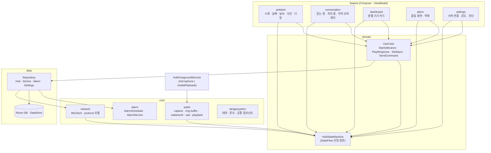
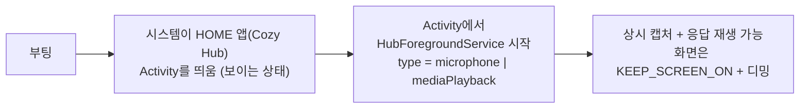
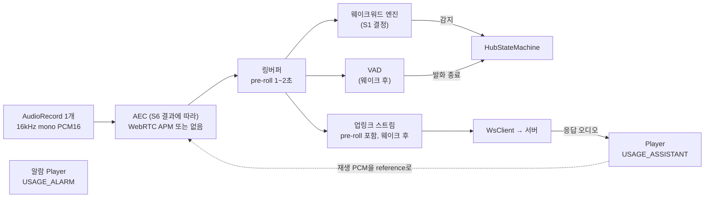
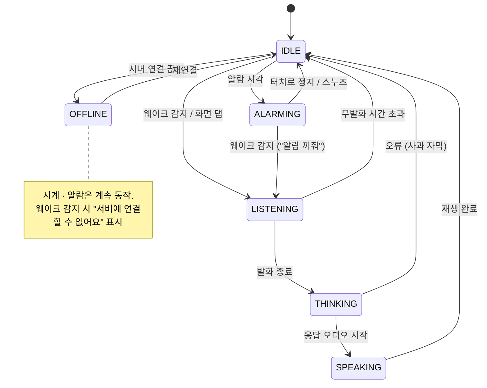
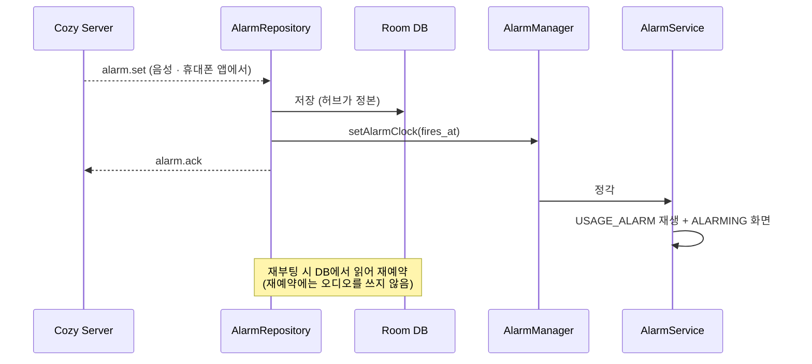

# 허브 아키텍처

Cozy Hub는 방마다 세워 두는 Android 태블릿 앱이다. 평소에는 Nest Hub처럼 앰비언트 시계 화면을 띄워
두고, 호출어를 들으면 발화를 서버로 보낸 뒤 응답을 재생한다. 알람·타이머는 서버 없이 허브가 직접
울린다. 이전 시도의 UI 방향(앰비언트 시계, 대화 오버레이)은 유지하고, 오디오·상시 구동·알람 구조는
2026-11 기준 Android 제약에 맞춰 다시 설계한다. 전체 구조는
[전체 시스템 아키텍처](0001-system-architecture.md)를 따른다.

## 제안 요약

허브의 책임은 다섯 가지다.

1. 앰비언트 화면: 시계, 날짜, 날씨, 사진을 상시 표시하고 조도·시간에 따라 디밍한다.
2. 음성 입력: 마이크를 상시 캡처해 호출어를 감지하고, pre-roll을 포함한 발화를 서버로 스트리밍한다.
3. 응답 표시와 재생: 상태 애니메이션, 자막, 응답 오디오를 앰비언트 화면 위의 오버레이로 보여 준다.
4. 알람·타이머: 로컬에 저장하고 `AlarmManager`로 예약해, 서버·인터넷과 무관하게 울린다.
5. 방 대시보드: 서버가 중계한 HA 상태로 기기 카드를 그리고 터치 제어를 서버에 보낸다.

음성 인식, 대화 판단, 기기 연결은 허브가 하지 않는다. 허브는 Cozy Server만 상대한다.

## 설계

### 앱 구조



전역 Android 규약(Kotlin, Compose, Hilt, Coroutines, MVVM, `strings.xml`, Timber)을 따르고, 패키지는
feature-first로 나눈다. View에는 로직을 두지 않고, 화면 전환과 오디오 상태는 `HubStateMachine`의 StateFlow
하나가 결정한다. 디자인 시스템(`core/designsystem`)은 휴대폰 앱과 공유할 수 있게 분리해 둔다.

```
hub/
└── app/src/main/java/.../cozybuddy/hub/
    ├── di/
    ├── core/
    │   ├── audio/        # capture · buffer · wakeword · vad · playback
    │   ├── network/      # WsClient · 재연결 · protocol 모델
    │   ├── alarm/        # AlarmScheduler · AlarmReceiver · AlarmService
    │   └── designsystem/
    ├── service/          # HubForegroundService
    ├── data/             # repository · local(Room, DataStore)
    ├── domain/           # HubStateMachine · usecase · model
    └── feature/          # ambient · conversation · dashboard · alarm · settings
```

### 상시 구동

Android 17은 보이는 Activity나 while-in-use(WIU) 권한을 가진 FGS가 없는 앱의 오디오 재생·포커스·볼륨
호출을 조용히 무시하고, `BOOT_COMPLETED`에서 시작한 FGS의 오디오를 차단한다. 마이크 FGS도 앱이 보일 때
시작해야 마이크 권한을 받는다. 그래서 허브는 다음 순서로 기동한다.



- Cozy Hub를 기본 HOME 앱으로 지정해 부팅하면 바로 보이는 Activity로 뜨게 한다. `BOOT_COMPLETED`
  리시버에서 FGS를 시작하지 않는다.
- 알람음은 `USAGE_ALARM`과 exact alarm 권한으로 재생한다. Android 17의 WIU 요구가 면제되는 경로다.
- Device Owner와 LockTask는 기본 구조에 넣지 않는다. 시스템 퀵설정을 그대로 쓸 수 있고, 앱이 비정상
  종료돼도 런처로 복구할 수 있기 때문이다. S5의 72시간 상시 구동 결과에서 HOME 앱만으로 복귀가 보장되지
  않을 때만 도입한다(검토 M10).

### 오디오 파이프라인



이전 설계에서 유지한 원칙은 세 가지다. `AudioRecord`는 하나만 두고 앱 안에서 나눠 쓴다. 웨이크 감지
이전 오디오도 pre-roll로 보내 첫 음절을 잃지 않는다. 추론 엔진마다 스레드 하나로 호출을 직렬화한다.
엔진은 정하지 않았다. 웨이크워드는 microWakeWord, LiveKit wakeword, 직접 학습한 한국어 모델을 S1에서
비교한다. AEC 적용 여부와 재생 중 웨이크 허용(끼어들기)은 S6에서 정한다. S6 결과가 나오기 전 기본값은
응답 재생 중 웨이크 임계값을 올리는 방식이다. 단, 알람이 울리는 동안에는 "알람 꺼줘"를 받을 수 있어야
하므로 웨이크를 끄지 않는다.

### 상태 머신



### 알람·타이머



알람의 정본은 허브다. 서버는 휴대폰 앱이 볼 수 있게 사본을 가진다. 연결이 끊긴 동안 허브에서 바꾼 알람은
재연결할 때 서버로 올린다. 선라이즈 알람(밝기를 점점 올리는 연출)은 같은 경로에 화면 연출만 더한다.

### 화면

| 화면 | 내용 | 규칙 |
|---|---|---|
| 앰비언트 (기본) | 이전 목업을 계승한 플립 시계(다크 기본, 큰 숫자, 하단 날짜 줄), 날씨, 사진 프레임 | 항상 돌아오는 화면. 조도·시간 기반 디밍, 번인 방지를 위해 픽셀 이동 |
| 대화 오버레이 | 듣는 중 파형, 처리 중 애니메이션, 응답 자막 | 화면을 전환하지 않고 앰비언트 위에 얹는다 |
| 대시보드 | HA area별 기기 카드, 토글·슬라이더 | 좌우 스와이프로 연다. 상태는 서버 push로 갱신 |
| 알람 | 울림 화면(정지·스누즈), 알람 목록 | 울림 화면은 다른 모든 화면 위에 표시 |
| 설정 | 서버 주소와 연결, 웨이크 감도, 마이크 음소거, 오디오 진단 | 첫 설정 때 마이크 캡처 점검 포함 |

UI 규칙과 디자인 토큰은 `docs/ui/`의 UI 가이드로 분리한다. 이전 목업은
`docs/legacy/ui/hub-ambient.html`, 이전 Compose 화면은 `docs/legacy/SOURCE.md`에 적은 revision에 있다.

### 서버와의 통신

| 방향 | 메시지 묶음 | 비고 |
|---|---|---|
| 허브 → 서버 | 인증, 발화 시작·오디오·종료·취소, 터치 명령, 허브 상태, 알람 동기화 | 오디오 프레임에 스트림 종류·세션·순번 포함 |
| 서버 → 허브 | 상태 지시, 자막, 응답 오디오, 기기 상태 push, 알람 설정 명령, 방송 | 응답 오디오와 방송 오디오는 스트림 종류로 구분 |

연결이 끊기면 지수 백오프(1초부터 최대 30초)로 재연결한다. 메시지 정의는 `protocol/`이 정본이다.

### 하드웨어

기종은 S1에서 정한다. 선정 기준은 원거리 수음 성능, 조도 센서, 충전 상한 설정(장시간 충전 시 배터리
부풀음 대책), LCD 패널(번인), Android 버전과 보안 업데이트 기간이다. 외부 마이크 어레이를 쓸지도 S1에서
판단한다.

### 미결 사항

- 웨이크워드 엔진과 호출어, 태블릿 기종: S1
- AEC 적용과 끼어들기: S6
- Device Owner 필요 여부: S5
- 사진 프레임의 사진 출처(로컬 폴더, NAS, 사진 서비스): 첫 루프 이후
- 디자인 시스템을 휴대폰 앱과 Gradle 모듈로 공유할지: [휴대폰 앱](0004-mobile-architecture.md)의 스택 결정과 함께
