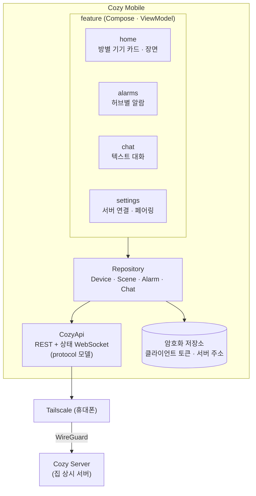
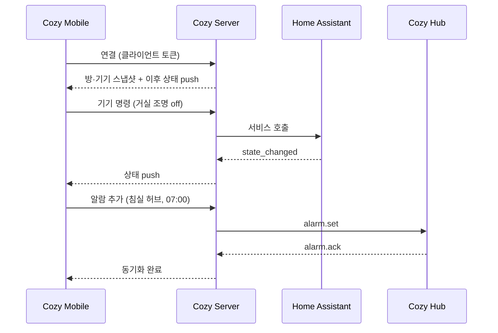

# 휴대폰 앱 아키텍처

Cozy Mobile은 집 밖에서 집을 제어하는 얇은 클라이언트다. 기기 제어, 장면 실행, 허브 알람 확인·설정,
텍스트 대화를 제공하고, 판단은 모두 Cozy Server에 맡긴다. 외부 접속은 Tailscale을 거치므로 서버를
인터넷에 직접 노출하지 않는다. 전체 구조는 [전체 시스템 아키텍처](0001-system-architecture.md)를 따른다.

## 제안 요약

휴대폰 앱의 범위는 다음 네 가지다.

| 기능 | 설명 |
|---|---|
| 기기 제어 | HA area별 기기 카드, 토글·슬라이더, 실시간 상태 |
| 장면 실행 | HA 장면·스크립트 목록을 실행 ("외출", "굿나잇") |
| 허브 알람 | 허브별 알람 목록 조회, 추가·삭제. 허브가 오프라인이면 "전달 대기" 표시 |
| 텍스트 대화 | 서버의 대화 에이전트와 텍스트로 대화. 음성 없이 같은 에이전트를 사용 |

이 앱이 하지 않는 일도 정한다. 음성 입력, 기기 등록(HA 앱으로 함), 자동화 편집(HA로 함), 허브 설정
변경(허브에서 함)은 범위 밖이다. HA 공식 앱이 기기 제어를 이미 제공하므로, 이 앱이 따로 있는 이유는
허브 알람과 Cozy 대화를 같은 화면에서 다루는 데 있다. 첫 루프(허브 1대 음성 제어 + 로컬 알람)가 완료된
뒤에 착수한다.

## 설계

### 구조



화면 상태는 ViewModel의 StateFlow로 표현하고, 서버 응답을 그대로 그린다. 오프라인 캐시는 마지막으로 받은
기기 상태 표시용으로만 둔다. 캐시된 상태에서는 제어 버튼을 비활성화해, 실제 상태를 모른 채 명령을 보내지
않게 한다.

### 주요 흐름



허브가 오프라인이면 서버가 알람 변경을 보관하고, 앱에는 "전달 대기"로 표시한다. 허브가 재연결하면 서버가
전달하고 앱 표시를 갱신한다.

### 외부 접속과 인증

| 항목 | 방식 | 이유 |
|---|---|---|
| 네트워크 | Tailscale. 서버와 휴대폰을 같은 tailnet에 둔다 | 포트 포워딩과 공인 노출이 없다. 집 안에서도 같은 주소로 접속할 수 있다 |
| 앱 인증 | 서버가 발급한 클라이언트 토큰. 허브 설정 화면이나 서버 관리 화면의 QR로 페어링 | 가족 몇 명 규모라 OAuth 서버는 과하다(검토 M14). 토큰은 개별 폐기 가능 |
| 토큰 저장 | Android Keystore로 암호화한 DataStore | |

Tailscale 앱을 설치하지 않은 가족 구성원은 앱을 쓸 수 없다. 이 제약이 받아들여지지 않으면 공개 터널
(Cloudflare Tunnel 등)과 앱 인증 강화를 함께 검토한다.

### 기술 스택

| 안 | 장점 | 비용 |
|---|---|---|
| Android 전용 Kotlin + Compose | 허브와 같은 스택이라 디자인 시스템과 `protocol/` 모델을 Gradle 모듈로 공유할 수 있다. 추가로 배울 것이 없다 | iPhone 사용자는 쓸 수 없다 |
| Compose Multiplatform (Android + iOS) | Kotlin 하나로 iOS까지 지원하면서 허브와 코드를 공유한다 | iOS 빌드 환경과 플랫폼별 차이를 처리해야 한다 |
| Flutter | iOS 지원이 성숙했다 | 세 번째 언어(Dart)가 생기고, 허브와 코드를 공유할 수 없다(검토 M14) |

가족 중 iPhone 사용자가 없으면 Android 전용 Kotlin + Compose를 쓴다. 있으면 Compose Multiplatform을
검토한다. 어느 쪽이든 Flutter는 쓰지 않는다. 가족 기기 구성을 확인한 뒤 ADR로 확정한다.

모노레포에서 허브와 공유할 후보는 두 가지다. `protocol/`에서 생성한 메시지 모델과, 색·폰트·공통
컴포넌트를 담은 디자인 시스템이다. 공유 모듈의 위치(`shared/` 또는 `protocol/kotlin/`)는 허브 스캐폴딩
때 정한다.

### 코드 구조 (Android 전용 안)

```
mobile/
└── app/src/main/java/.../cozybuddy/mobile/
    ├── di/
    ├── core/
    │   ├── network/      # CozyApi · 상태 WebSocket · 재연결
    │   ├── security/     # 토큰 저장 (Keystore)
    │   └── designsystem/ # 허브와 공유 후보
    ├── data/             # repository
    └── feature/          # home · alarms · chat · settings
```

### 미결 사항

- iOS 지원 여부와 그에 따른 스택: 가족 기기 확인 후 ADR
- 외부 접속을 Tailscale로만 할지: 가족 구성원의 Tailscale 설치 가능 여부 확인
- 푸시 알림(문 열림, 알람 미해제 등)을 넣을지: 넣으려면 FCM 같은 외부 서비스가 필요하다. 첫 범위에서는 제외
