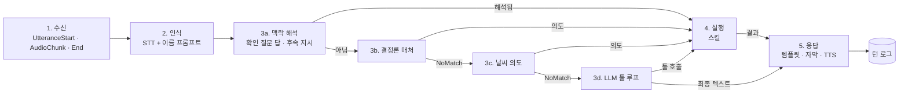
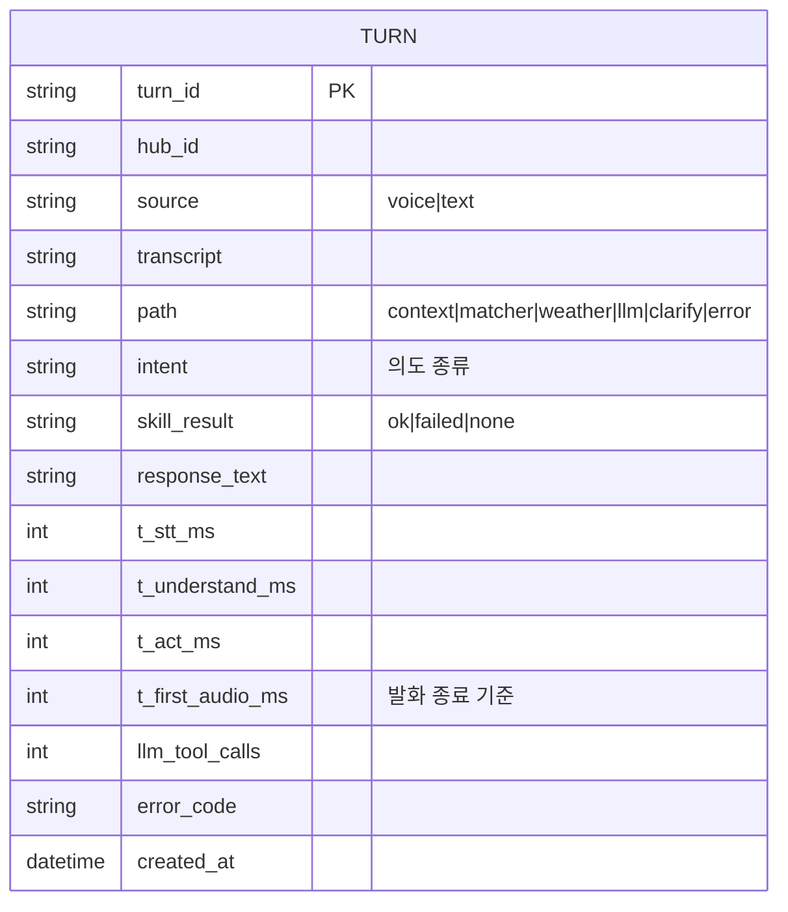

# 백엔드 처리 파이프라인

서버의 발화 처리를 이해·실행·응답의 단계로 나누고, 단계마다 계약·시간 제한·실패 처리·측정 지점을 정한다.
결정론 매처와 LLM이 같은 실행 계층(스킬)을 쓰게 해서 기기 제어·알람 로직이 두 벌로 갈라지지 않게 한다.
모든 발화는 단계별 시간과 결과를 담은 턴 기록으로 남는다. 그래서 실기기 없이도 지연과 결정론 처리
비율을 잴 수 있다. 이 설계는 [서버 설계안](0002-server-architecture.md)의 대화 처리 흐름을 구체화하고,
다음 작업 묶음(W1·W2)의 기준이 된다.

## 제안 요약

현재 구조의 문제는 세 가지다.

- `agent/service.py`가 800줄이다. 매처 결과 실행, 알람 탐색, LLM 툴 처리, 확인 질문, 날씨가 한 클래스에 있다.
  게다가 같은 동작(알람 설정·취소, 기기 제어)이 결정론 경로와 LLM 툴 경로에 따로 구현돼 있다.
- 단계별 시간과 경로를 남기는 곳이 없다. 지연·결정론 비율은 외부 도구(가상 허브)로만 잴 수 있고, 실제
  사용 기록으로 S9(결정론 커버리지)를 판단할 근거가 쌓이지 않는다.
- 후속 지시("그거 다시 켜줘", "더 밝게")와 울리는 알람을 음성으로 끄는 흐름이 없다.

제안하는 구조는 다음 다섯 단계다.

| 단계 | 하는 일 | 소유 모듈 | 시간 제한 |
|---|---|---|---|
| 1. 수신 | 발화 스트림 검증, 버퍼링, 취소 | `voice/session.py` | 발화 최대 15초 |
| 2. 인식 | 음성 → 텍스트 (STT, 방·기기 이름 프롬프트) | `voice/` + `core/openai_gateway.py` | 10초 |
| 3. 이해 | 텍스트 → 의도. 대화 맥락 해석 → 결정론 매처 → 날씨 → LLM 순서 | `agent/understand/` | 매처 즉시, LLM 조각 간 10초 |
| 4. 실행 | 의도 → 스킬 호출(기기, 장면, 상태, 알람, 날씨, 알람 제어) | `agent/skills/` | 스킬별 5초 |
| 5. 응답 | 템플릿 또는 LLM 텍스트 → 자막 + 문장 단위 TTS | `voice/responder.py` | TTS 문장당 10초 |

각 발화는 `Turn` 객체 하나가 처음부터 끝까지 들고 다닌다. `Turn`은 단계별 시각, 경로(결정론·LLM·확인 질문),
의도, 스킬 결과, 오류를 기록하고, 끝나면 턴 로그에 저장된다.

## 설계

### 단계 흐름

### 이해 단계

`Understander`가 아래 순서로 시도하고, 처음 의도를 낸 단계에서 멈춘다. 순서를 바꿀 때 영향 범위가 한 곳에
있게 하려고 각 시도를 같은 인터페이스(`text, TurnContext → Intent | None`)로 둔다.

1. 맥락 해석: 같은 허브의 보류 중인 확인 질문(30초) 답, 또는 직전 턴의 대상에 대한 후속 지시. 후속 지시는
   결정론으로만 해석한다. 대상 엔티티는 직전 턴 기록의 대상을 쓰고, 유효 시간은 60초다. 예: "그거 다시 켜줘",
   "더 밝게", "아니 침실 거".
2. 결정론 매처: 기존 `match()`.
3. 날씨 의도: 기존 `match_weather()`.
4. LLM 툴 루프: 기존 규칙(`role:"tool"`, 최대 5회, 마지막 턴 스트리밍)을 유지한다. 최근 3턴의 사용자 발화와
   응답을 맥락으로 넣는다. 툴은 스킬 목록에서 생성한다.

### 실행 단계: 스킬

스킬은 의도를 받아 실행하고 `SkillResult(ok, response_key, args, entities)`를 돌려준다. 결정론 의도와 LLM 툴
호출은 모두 스킬로 들어온다. LLM 툴 스키마는 각 스킬의 툴 정의에서 생성한다.

| 스킬 | 의도 | 의존 |
|---|---|---|
| DeviceSkill | DeviceCommand, SceneCommand, 후속 지시 | HomeService |
| StateSkill | StateQuery | HomeService 캐시 |
| AlarmSkill | AlarmIntent, TimerIntent, CancelAlarmIntent | AlarmService |
| AlarmControlSkill | 울리는 알람 정지·스누즈 (신규) | 허브 연결 |
| WeatherSkill | WeatherIntent | WeatherService |

울리는 알람의 음성 제어는 새 프로토콜 메시지가 필요하다. 허브는 알람이 울리는 동안 웨이크워드를 받는다.
그러면 "알람 꺼", "5분 뒤에 다시"를 서버가 해석하고, 그 허브에 `AlarmControl(alarm_id, STOP | SNOOZE)`를
보낸다. 허브는 이미 오버레이 버튼과 같은 처리 경로를 가지고 있다. 허브가 울리는 중인 알람을 서버에
알려야 하므로 `HubStatus`에 `ringing_alarm_id`를 추가한다.

### 턴 기록

- 저장: SQLite `turn_log` 테이블. 오디오는 저장하지 않는다. 기본 보존 기간은 30일(`COZY_TURN_LOG_DAYS`)이다.
- 조회: `GET /api/system/turns?hub_id=&limit=`, `GET /api/system/turns/summary`(경로별 비율, 단계별 p50/p95).
  S9의 결정론 커버리지는 이 요약으로 판단한다.
- 로그: 턴이 끝날 때 한 줄 구조화 로그(`turn_id`, 경로, 단계 시간). 전사문은 디버그 수준에서만 남긴다.

### 실패 처리

| 단계 | 실패 | 처리 | 턴 기록 |
|---|---|---|---|
| 인식 | STT 오류·시간 초과 | "지금은 음성을 알아들을 수 없어요" 자막, 음성 없음 | path=error, error_code |
| 인식 | 빈 전사 | 되묻기 템플릿 | path=clarify |
| 이해 | LLM 시간 초과 | 사과 템플릿 | path=llm, error_code |
| 실행 | HA 다운·기기 오류 | HA 메시지 키를 그대로 응답 | skill_result=failed |
| 실행 | 허브 오프라인(알람 제어) | "허브에 연결할 수 없어요" | skill_result=failed |
| 응답 | TTS 실패 | 자막만 남기고 이후 문장 생략 | error_code |

### 성능 예산

결정론 경로의 목표는 발화 종료부터 첫 소리까지 p50 1.5초 이하다(현재 개발 서버 측정 약 1.5초). 예산의 대부분은
STT(약 0.65초)와 TTS 첫 바이트(약 0.8초)가 쓴다. 다음 단축 후보는 발화 중 스트리밍 전사다. STT를 발화 종료
전에 시작해 최대 약 0.6초를 줄일 수 있다는 가설이며, 스파이크 W1-4로 측정한 뒤 채택 여부를 정한다.

### 작업 묶음과 진행 방식

| 묶음 | 작업 | 선행 | 소유 파일 |
|---|---|---|---|
| W1-1 | 이해·실행 분리 리팩터: Understander, 스킬 5종(알람 제어 제외), `Turn` 객체, 턴 로그 저장과 조회 API | 없음 | `server/app/domain/agent/**`, 신규 `server/app/domain/telemetry/` |
| W1-2 | 런타임 의존성 누락 검사와 배포 후 스모크(#42) | 없음 | `server/scripts/`, `infra/devloop/` |
| W1-3 | 한국어 호출어 "자비스" 학습(#43) | 없음 | `spikes/s1-wakeword/`, 허브 모델 자산 |
| W1-4 | 스트리밍 전사 지연 스파이크 | 없음 | `spikes/` |
| W2-1 | 맥락 해석(후속 지시, 최근 3턴 LLM 맥락) | W1-1 | `agent/understand/` |
| W2-2 | 울리는 알람 음성 제어(`AlarmControl`, `HubStatus.ringing_alarm_id`) | W1-1 | protocol, `agent/skills/`, 허브 알람 |
| W2-3 | 스트리밍 전사 적용(W1-4 결과가 채택일 때) | W1-4 | `voice/` |

각 묶음은 같은 경로로 진행한다.

1. 작업 지시서: 소유 파일과 금지 범위를 명시한다.
2. worktree 브랜치에서 구현한다.
3. 컴포넌트 검사를 통과한다.
4. Mac에서 로컬 서버를 띄우고 가상 허브 점검 도구로 라이브 확인한다.
5. 검토하고 병합한다.
6. 개발 서버에 재배포하고 가상 허브 basic 시나리오로 회귀를 확인한다.

W1-1은 다른 서버 묶음과 같은 파일을 건드리므로, W2는 W1-1 병합 뒤에 시작한다.
