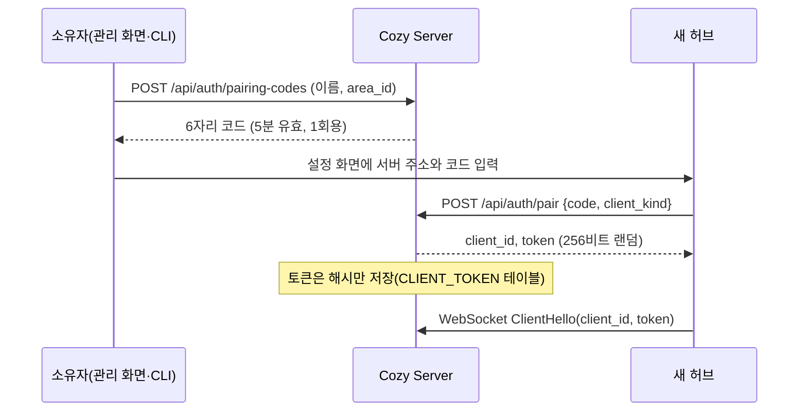

# 다중 허브 대비 기능 (W3)

허브가 여러 대가 되기 전에 필요한 서버 기능 네 가지와, 한국어 호출어 실험 옵션을 정한다.
네 가지는 허브 등록(페어링), 허브 간 방송, 말로 하는 리마인더, 여러 허브가 같은 말을 들었을 때의 중재다.
병렬로 구현할 수 있도록 프로토콜 번호와 소유 파일을 이 문서에서 미리 나눈다. 단계 구조는
[백엔드 파이프라인 설계안](0005-backend-pipeline.md)을 따른다.

## 제안 요약

| 묶음 | 기능 | 사용자 관점 | 프로토콜 |
|---|---|---|---|
| W3-1 | 허브 페어링 | 새 태블릿을 6자리 코드로 등록, 정적 토큰 대체 | REST만, Envelope 변경 없음 |
| W3-2 | 허브 간 방송 | "주방에 밥 먹으라고 방송해줘" → 주방 허브에서 음성 재생 | `BroadcastNotice` = 30 |
| W3-3 | 리마인더 | "내일 3시에 병원 가라고 알려줘" → 그 시각에 허브가 내용을 말함 | `AlarmKind.REMINDER` = 3, `ReminderFired` = 47 |
| W3-4 | 다중 허브 중재 | 거실·주방 허브가 같은 말을 들어도 한 곳만 응답 | `UtteranceDeclined` = 31 |
| W3-5 | 한국어 호출어 실험 옵션 | 허브 설정에서 "자비스(실험)" 선택, 기본은 "Hey Jarvis" | 없음 |

한국어 호출어는 한 음소 변형("저비스" 등)을 오탐에서 빼기로 했다(소유자 결정, 2026-11-19). 이 기준으로도 일반
음성 오탐이 시간당 1.4회 이상이라 기본값으로 두지 않는다. 실기기에서 직접 비교할 수 있게 선택 옵션으로만 넣는다.
이 수치는 일반 음성·소음 약 3.5시간(FLEURS 낭독 1.3시간과 그 TV 재생본, ESC-50 등)에서 임계값 0.95일 때 오탐 5건으로
잰 값이다(`spikes/s1-wakeword/results/ko_eval.json`의 `jarvis_ko_C`). 사건 수가 적어 95% 구간이 대략 시간당 0.5~3.3회로 넓고,
검출률 표본은 합성 음성이다. 실제 가정 소음과 사람 음성 기준은 #43의 녹음으로 다시 잰다.

## 설계

### W3-1 허브 페어링

- 저장: `client_token(token_id, client_id, kind, token_hash, created_at, revoked_at)`. 비교는 해시 후 상수 시간 비교.
- 정적 토큰(`COZY_STATIC_TOKENS`)은 개발용으로 계속 허용한다. 둘 다 없으면 인증 실패.
- 코드 시도는 IP별 분당 5회로 제한한다. 폐기는 `DELETE /api/auth/clients/{client_id}`이고, 연결된 세션은 즉시 끊는다.
- 관리 API는 LAN·Tailscale 안에서만 열고, 별도 관리자 토큰(`COZY_ADMIN_TOKEN`)을 요구한다.
- 허브 설정 화면에 "코드로 등록" 입력을 추가한다. 받은 토큰은 기존 Keystore 암호화 저장소에 넣는다.

### W3-2 허브 간 방송

- 이해: 매처 의도 `BroadcastIntent(target_area | all, message)`. 예: "주방에 밥 먹으라고 방송해줘", "다들 밥
  먹으라고 방송해줘". 메시지 추출이 애매하면 LLM 툴 `broadcast(target, message)`로 넘긴다.
- 실행: `BroadcastSkill`이 대상 허브(그 area의 허브, 또는 말한 허브를 뺀 전체)를 고른다. 문장을 TTS로 한 번
  합성해 각 허브에 `BroadcastNotice{from_hub_id, from_area, text, stream_id}`와
  `ResponseAudioStart(kind=BROADCAST_DOWN)` → `AudioChunk(kind=BROADCAST_DOWN)` → `ResponseAudioEnd`로 보낸다.
- 응답: 말한 허브에는 "주방에 방송했어요"(대상 허브 수, 오프라인 허브는 제외 안내).
- 허브: 이미 있는 방송 재생 경로를 쓴다. 대화 중이거나 알람이 울리면 방송은 재생하지 않고 자막만 남긴다.
- REST: `POST /api/broadcast {target, text}`(휴대폰 앱용 자리).

### W3-3 리마인더

- 이해: "내일 3시에 병원 가라고 알려줘", "30분 뒤에 빨래 꺼내라고 알려줘" → `ReminderIntent(시각, 내용)`.
  기존 알람 시각 해석을 재사용하고, 내용은 "~라고/~하라고" 앞부분이다.
- 저장: 허브가 정본인 기존 알람 구조를 쓰고 `AlarmKind.REMINDER`, 내용은 `label`에 둔다.
- 울릴 때: 허브는 오프라인에서도 알람과 같은 경로로 짧은 알림음과 화면 문구를 표시한다. 온라인이면
  `ReminderFired{alarm_id, label}`를 보내고, 서버가 "병원 가실 시간이에요" 같은 문장을 합성해 RESPONSE_DOWN으로
  내려보낸다. 음성 응답이 오면 알림음은 멈춘다.
- 정지·스누즈는 기존 알람 제어(W2-2)를 그대로 쓴다.

### W3-4 다중 허브 중재

같은 집에서 두 허브가 같은 발화를 동시에 보내면 하나만 처리한다.

- 판정 창: 발화 종료 시각 차이 1.2초 이내, 전사문 정규화 후 동일하거나 편집 거리 비율 0.8 이상. 단, 정규화 후
  10자 미만인 짧은 문장은 완전히 같을 때만 중복으로 본다. "거실 조명 꺼줘"와 "침실 조명 꺼줘"는 비율이 0.83이라
  서로 다른 명령을 중복으로 오판하기 때문이다.
- 대기: 먼저 끝난 발화는 기다리지 않는다. 나중에 끝난 발화의 STT가 먼저 끝나면, 더 일찍 끝난 다른 허브 발화를
  최대 0.3초 기다린다. 그 안에 결과가 오지 않으면 먼저 처리하고, 이 경우에는 이른 발화 쪽이 거절된다.
- 선택: 웨이크 점수나 음량 정보가 아직 없으므로 먼저 도착한 발화를 쓴다. 나중에 허브가 입력 음량을 보내면
  큰 쪽을 고르도록 확장한다. 그러려면 `UtteranceStart`에 `input_level_db` 필드를 추가한다(이번 범위는 필드
  예약만).
- 진 쪽 허브에는 `UtteranceDeclined{stream_id, reason=DUPLICATE, winner_hub_id}`를 보내고, 허브는 조용히 IDLE로
  돌아간다(오류 표시 없음).
- 턴 기록: 진 쪽 턴은 `path=declined`로 남기고, 결정론 비율 계산의 분모에서 뺀다.

### W3-5 한국어 호출어 실험 옵션

- 허브 자산에 `jarvis_ko`(평가 문턱 0.95에서 오탐이 가장 적었던 변형 C)를 추가하고 sha256 상수를 둔다.
- 설정 화면에 호출어 선택("Hey Jarvis" 기본, "자비스(실험)")을 넣는다. 문턱 기본값은 0.95다.
- 모델 파일은 Windows 개발 서버의 학습 결과(`~/dev/cozy-wakeword/models/jarvis_ko_C.onnx`)를 가져온다.

### 번호와 소유 파일

| 묶음 | 프로토콜 번호 | 소유 파일 |
|---|---|---|
| W3-1 | 없음 | `server/app/domain/auth/`(신규), `core/security.py`, hub `feature/settings`·`core/network` 인증 부분 |
| W3-2 | Envelope 30 `BroadcastNotice` (`voice.proto`) | `agent/skills/broadcast.py`, 매처 방송 의도, `domain/broadcast/`(REST), hub 방송 재생 |
| W3-3 | `AlarmKind.REMINDER` = 3, Envelope 47 `ReminderFired` (`alarm.proto`) | `agent/skills/alarm*.py`의 리마인더 부분, 매처 리마인더 의도, hub `feature/alarm` |
| W3-4 | Envelope 31 `UtteranceDeclined`, `UtteranceStart.input_level_db` = 6 (`voice.proto`) | `voice/arbiter.py`(신규), `voice/session.py`의 진입 부분, hub `domain/voice` 거절 처리 |
| W3-5 | 없음 | hub `core/audio/wakeword`, 설정, 자산 |

프로토콜 파일이 겹치는 W3-2와 W3-4는 같은 `voice.proto`를 수정하므로, 먼저 병합된 쪽 위에 다른 쪽을 rebase한다.
매처는 W3-2·W3-3이 각각 새 의도 감지 함수를 추가하고, 매처 진입점에는 한 줄씩만 더한다.

각 묶음은 설계안 0005의 진행 6단계를 따른다. 실기기가 없으므로 허브 동작은 유닛 테스트로 확인하고, 서버 동작은
가짜 허브 두 대를 띄우는 가상 허브 점검으로 확인한다.
